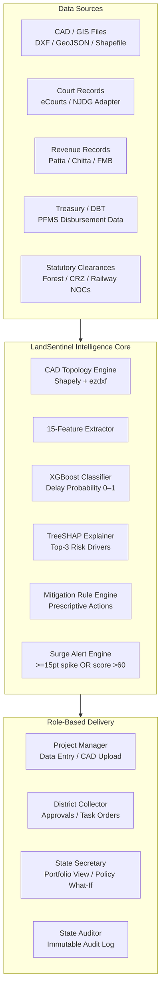

<div align="center">

# LandSentinel

### *India's AI-Powered Land Acquisition Intelligence Platform*

**Stop discovering delays after they happen. Start preventing them 6–12 months in advance.**

[](https://www.python.org/)
[](https://fastapi.tiangolo.com/)
[](https://react.dev/)
[](https://xgboost.readthedocs.io/)
[](https://supabase.com/)
[](LICENSE)

</div>

---

## The Problem — In One Sentence

> **Indian infrastructure projects (highways, railways, canals) lose 18–36 months** to land acquisition bottlenecks that no one sees coming — until a bulldozer stops and a court notice arrives.

**Root causes:** unresolved land titles, stalled statutory clearances, undelivered compensation, and mismatched paper maps — all tracked in disconnected Excel sheets, manual MIS portals, and physical files.

---

## What LandSentinel Does — In 30 Seconds

```
Fragmented admin data    ──►   AI Risk Engine   ──►   Prescriptive Alerts
(Courts, CAD files,            (XGBoost + SHAP)       (To the right officer,
 Revenue records,                                      at the right time,
 Compensation DBT,                 6–12 months          with the exact
 Statutory clearances)            in advance)          action to take)
```

| Without LandSentinel | With LandSentinel |
|:---|:---|
| Discover delays via monthly MIS reports | AI flags delay risk **6–12 months ahead** |
| Manual survey number entry from paper maps | Upload a CAD file -> parcels auto-extracted in seconds |
| "Why is this project high risk?" — no answer | Top-3 SHAP risk drivers with plain-language justification |
| Guess impact of policy interventions | Simulate *"what if we release 50% compensation?"* live |
| Flat access — anyone sees any district | Cryptographic district scoping (RFCTLARR §3(g)) |

---

## How the System Works



---

## Five Key Capabilities (USPs)

### 1. Predict Delays — Not Just Report Them
Traditional MIS portals show you *what already happened*. LandSentinel's calibrated **XGBoost model** analyses 15 live project features and outputs a **delay probability score (0.0 to 1.0)** and **expected delay in days** — giving administrators up to **12 months of advance warning** before a project stalls.

### 2. Upload a CAD File -> Get Survey Schedules Instantly
No more typing hundreds of survey numbers from paper sketches. Drop an **AutoCAD DXF**, **GeoJSON**, or **Zipped Shapefile** into LandSentinel. The geometry engine:
- Extracts parcel boundaries with topological repair (`make_valid`)
- Ray-casts survey number labels into their correct parcel polygons
- Reprojects arbitrary CAD coordinate spaces to WGS 84 for live Leaflet map preview
- Auto-fills the Land & Parcels acquisition schedule in seconds

### 3. Explain *Why* — Not Just *What*
Every risk score is decomposed using **TreeSHAP** (game-theoretic feature attribution) into the **Top 3 mathematical contributors**, translated into institutional plain English:

> *"Compensation pending at 73% is the primary delay driver — initiate DBT payouts to the 14 outstanding survey accounts under RFCTLARR §77 to reduce risk by an estimated 18 points."*

### 4. Simulate Policy Before Executing It
The **What-If Sensitivity Simulator** is a live policy workbench. District Collectors can slide parameters — compensation release %, number of court cases, approval delays, document completion — and watch the ML model **recalculate risk scores in real time (debounced 400 ms)**. No guesswork. No committee meetings. Instant data-driven answers.

### 5. Constitutional Jurisdiction Enforcement
Every user is cryptographically scoped to their administrative jurisdiction via **HS256 JWT tokens**. District Collectors are **strictly quarantined** to their district under RFCTLARR Section 3(g). A Thoothukudi Collector cannot view Kanchipuram projects — not by convention, but by enforced token validation on every API call.

---

## Who Uses LandSentinel

<table>
<tr>
<td width="33%">

**Project Manager**  
*Priya Sharma — Kanchipuram Corridor*

- Upload CAD/GIS boundary files
- Log telemetry updates (court cases, compensation, clearances)
- Run What-If scenario planning
- Monitor AI-generated alerts

</td>
<td width="33%">

**District Collector**  
*Dr. K. Senthilraj — Thoothukudi*  
*Rajesh Patil — Kanchipuram*

- View district-scoped geospatial risk map
- Issue statutory task orders to field officers
- Track per-parcel compensation & court case status
- Approve clearances with AI risk context

</td>
<td width="33%">

**State Policy Secretary**  
*Dr. Sunita Deshmukh — Tamil Nadu*

- Statewide portfolio risk dashboard
- Cross-corridor policy What-If simulation
- Identify systemic bottlenecks across districts
- Monitor RFCTLARR statutory compliance

</td>
</tr>
<tr>
<td width="33%">

**System Administrator**  
*Anand Verma*

- ML model retraining studio
- System health & audit trail
- User & district configuration
- Manage CAD layer conventions

</td>
<td width="33%">

**State Auditor**  
*Kavita Rao*

- Immutable read-only audit log
- Compensation disbursement verification
- Court case & stay order audit trail
- Compliance directorate reporting

</td>
<td width="33%">

**Demo Credentials**  
*Try any role instantly:*

| Role | Email |
|:---|:---|
| PM | `pm1@` |
| Collector | `collector1@` |
| Secretary | `policymaker1@` |
| Admin | `admin1@` |
| Auditor | `auditor1@` |

*All `@landsentinel.gov.in` · password: `demo123`*

</td>
</tr>
</table>

---

## The 15 AI Features — Spanning the Entire Statutory Lifecycle

LandSentinel's model monitors the **full RFCTLARR Act lifecycle** — from Social Impact Assessment through Resettlement & Rehabilitation:

| # | Feature | What It Measures | Statutory Reference |
|:-:|:---|:---|:---|
| 1 | `land_area_ha` | Total acquisition footprint (hectares) | RFCTLARR §4 SIA |
| 2 | `families_affected` | Project-affected families needing R&R | RFCTLARR §16 R&R |
| 3 | `project_type` | Sector: highway / rail / power / irrigation / urban | §2(7) Definition |
| 4 | `litigation_cases` | Active court cases filed across corridor parcels | eCourts / NJDG |
| 5 | `stay_orders` | Active injunctions legally halting construction | High Court Orders |
| 6 | `ownership_disputes` | Title / mutation disputes among co-heirs | Revenue Records |
| 7 | `compensation_pending_pct` | % of statutory award funds not yet disbursed | RFCTLARR §23/31 |
| 8 | `approval_days_pending` | Max days overdue among pending clearances | MoEFCC / Forest / CRZ |
| 9 | `docs_incomplete_pct` | % of parcels with unverified Patta / land records | FMB / Adangal |
| 10 | `officer_response_days` | Avg. revenue query turnaround (days) | Taluk SLA |
| 11 | `encroached_area_pct` | % of right-of-way under encroachment | Site Incident Reports |
| 12 | `possession_pct` | % land physically handed over (>=70% -> risk reduction) | RFCTLARR §38 |
| 13 | `rr_progress_pct` | Resettlement housing & livelihood scheme progress | RFCTLARR §16 |
| 14 | `current_stage` | Lifecycle phase (planning -> sia -> award -> possession -> rr) | Statutory Progression |
| 15 | `district_past_delay_rate` | Historical land acquisition delay rate for the district | District Benchmark |

---

## Parcel-Level Intelligence — Survey Number Precision

LandSentinel doesn't just track projects — it tracks **individual survey parcels**:

```
Project NH-48 Corridor
|
+-- Survey 104/1A   Court Case: WP/23456/2024 (Stay Order ACTIVE) [Blocked]
|   \-- Compensation: Pending Payment
|
+-- Survey 104/2    No litigation
|   \-- Compensation: Disbursed via DBT -> Section 38 Possession Unlocked
|
\-- Survey 105/1    Court Case: OS/1122/2024 (Title Dispute)
    \-- Compensation: Disputed (Escrow Deposit) -> construction can proceed
```

**Compensation States tracked per parcel:**
- **Pending Payment** — Awaiting landowner KYC or Patta verification
- **Disbursed (Paid via DBT)** — Funds transferred directly to bank; unlocks physical possession
- **Disputed (Escrow Deposit)** — Contested funds in LARRA Escrow; construction proceeds legally

> **Government & Forest Land**: Public land (assigned Patta, revenue poramboke, reserved forest) is tracked for demarcation and possession without compensation obligation — the system flags it separately from private parcel award calculations.

---

## The What-If Simulator — Policy Testing Without Consequences

> *"If the District Collector releases 50% of pending compensation, reduces approval backlog from 150 to 60 days, and resolves 2 court cases — what happens to the project's delay risk?"*

The **Sensitivity Parameter Sliders** answer this in milliseconds:

| Parameter | Slide To Simulate | Risk Impact |
|:---|:---|:---|
| Compensation Pending % | 0% -> 100% | Major driver — high pending % sharply raises risk |
| Number of Court Cases | 0 -> 20 | Exponential weight for stay orders |
| Documents Incomplete % | 0% -> 100% | Cascading effect on possession readiness |
| Approval Days Pending | 0 -> 365 days | Broken down by named clearance type (Forest, CRZ, Railway NOC...) |

Each slider shows **current baseline vs. simulated value** side by side, with the ML model recalculating delay probability in real time.

---

## Tech Stack

```
+---------------------------------------------------------+
|  FRONTEND          |  BACKEND           |  ML / DATA    |
|  React 18 + Vite   |  FastAPI + Uvicorn |  XGBoost      |
|  Tailwind CSS      |  Pydantic v2       |  SHAP         |
|  Recharts          |  PyJWT (HS256)     |  Scikit-Learn |
|  React-Leaflet     |  Python-Multipart  |  NumPy/Pandas |
|  Lucide Icons      |                    |  Joblib       |
+--------------------+--------------------+---------------+
|  GEOSPATIAL / CAD  |  DATABASE          |  TESTING      |
|  Shapely           |  Supabase          |  Pytest (10+) |
|  PyProj            |  PostgreSQL + RLS  |  Vite Build   |
|  ezdxf             |  Row Level         |  CAD Fixture  |
|  GeoPandas / Fiona |  Security (RLS)    |  Test Suite   |
+--------------------+--------------------+---------------+
```

---

## Quick Start — Up in 5 Minutes

### Prerequisites
- Python 3.10+ · Node.js 18+ · npm

### Step 1 — Clone
```bash
git clone https://github.com/Prakashraj-007/Predictive-Analytics-System-for-Early-Detection-of-Land-Acquisition-Delays.git
cd Predictive-Analytics-System-for-Early-Detection-of-Land-Acquisition-Delays
```

### Step 2 — Backend
```bash
python -m venv venv
venv\Scripts\activate          # Windows
# source venv/bin/activate     # Linux / macOS

pip install -r backend/requirements.txt
pip install ezdxf shapely pyproj

cd backend
uvicorn app.main:app --host 0.0.0.0 --port 8000 --reload
```

### Step 3 — Frontend
```bash
# In a new terminal
cd frontend
npm install
npm run dev
```

Open **`http://localhost:5173`** -> Click **Quick Login** -> Choose any role persona -> Explore!

---

## Run the Test Suite

```bash
# CAD geometry & topology tests
python -m pytest tests/test_cad_parser.py -v

# ML prediction service tests
python -m pytest tests/test_prediction_service.py -v

# Frontend production build verification
npm --prefix frontend run build
```

---

## Documentation

| File | Contents |
|:---|:---|
| [`docs/contracts.md`](docs/contracts.md) | API schemas, ML feature contracts, DB specs |
| [`docs/cad_layer_convention.md`](docs/cad_layer_convention.md) | DXF/GeoJSON/Shapefile layer standards & CRS rules |
| [`docs/architecture.md`](docs/architecture.md) | Adapter pattern, ML pipeline, RBAC guards |
| [`docs/recommendation_rules.md`](docs/recommendation_rules.md) | SHAP driver -> mitigation protocol mapping |

---

<div align="center">

**Built for India's Infrastructure Governance**  
*RFCTLARR Act, 2013 · District Collector Administration · Public Works Departments*

*LandSentinel — From reactive firefighting to proactive, data-driven land governance.*

</div>
