# LandSentinel: Predictive Analytics System for Early Detection of Land Acquisition Delays

> **AI-Powered Infrastructure Governance & Cadastral Risk Intelligence Platform**  
> *Transforming statutory land acquisition from reactive dispute firefighting into proactive, data-driven pre-emption.*

[](https://www.python.org/)
[](https://fastapi.tiangolo.com/)
[](https://vitejs.dev/)
[](https://tailwindcss.com/)
[](LICENSE)

---

## 1. Executive Summary & Problem Statement

Linear infrastructure projects in India (national expressways, freight corridors, high-speed rail, irrigation canals, and industrial corridors) suffer average delays of **18 to 36 months** during the pre-construction statutory land acquisition phase. Over **70% of delays** stem from uncoordinated bottlenecks:

1. **Title & Ownership Disputes**: Litigations filed in District Courts and High Courts resulting in ad-interim stay orders.
2. **Statutory Approval Inertia**: Inter-departmental clearance delays (Forest Stage-I/II, Coastal CRZ, Railway ROB, Environmental Sanctions).
3. **Compensation Disbursement Friction**: Delayed valuation awards and disputes over Solatium under the **RFCTLARR Act, 2013**.
4. **Cadastral Demarcation Gaps**: Disconnect between engineering CAD design drawings and ground-level village revenue maps (*FMB / Adangal*).

Traditionally, state administrative departments discover these compounding delays months after critical milestones have lapsed.

**LandSentinel** solves this challenge by integrating fragmented administrative data streams across revenue registries, district courts, clearance portals, and treasury disbursement records. Using calibrated machine learning (**XGBoost**) and game-theoretic explainability (**TreeSHAP**), LandSentinel quantifies delay probabilities up to **6 to 12 months in advance**, identifies the exact operational drivers behind risk spikes, and delivers automated, prescriptive policy recommendations directly to District Collectors and Project Managers.

---

## 2. Unique Selling Propositions (USPs)

| # | Unique Selling Proposition (USP) | Industry Baseline (Traditional MIS) | LandSentinel Breakthrough |
| :-: | :--- | :--- | :--- |
| **1** | **Predictive Delay Intelligence (vs. Historical Reporting)** | MIS portals only report past milestones (e.g., *"Approval is 120 days late"*). | Uses trained machine learning models to forecast **delay probability (0.0–1.0)** and **expected delay days** 6–12 months before construction halts. |
| **2** | **Automated CAD/GIS Demarcation & Schedule Extraction** | Manual data entry of hundreds of survey numbers, boundaries, and land areas from paper sketches. | Native ingestion of **AutoCAD DXF, GeoJSON, and Zipped Shapefiles** with point-in-polygon ray casting and CRS reprojection, auto-filling Demarcated Parcels Schedules in seconds. |
| **3** | **Explainable AI (XAI) with Plain-Language Translation** | Black-box ML predictions that administrators distrust and reject. | Decomposes risk scores into **Top-3 mathematical contributors** using TreeSHAP, accompanied by institutional plain-language justifications and actionable mitigation protocols. |
| **4** | **Counterfactual "What-If" Sensitivity Simulator** | Decision-makers must guess the impact of policy interventions. | Live policy workbench allowing Collectors to simulate counterfactuals (*"What if we release 50% compensation or vacate 2 stay orders?"*) with instant recalculation of risk scores. |
| **5** | **Constitutional & Statutory Role-Based Scoping** | Flat administrative access risking data leakage across jurisdictions. | Cryptographically enforced **District Scoping** under Section 3(g) of the RFCTLARR Act—District Collectors are strictly quarantined to their district, while State Secretaries retain portfolio-wide visibility. |

---

## 3. Core Technical Novelties

### A. High-Precision CAD Demarcation & Geometric Topology Engine
* **Universal Vector Parsing**: Server-side parsing of **AutoCAD DXF**, **GeoJSON**, and **Zipped Shapefiles** (with direct rejection and export guidance for proprietary binary DWG).
* **Strict Outer Boundary Enforcement**: Merges multi-part boundary segments using topological `unary_union`. Disallows artificial convex hulls and returns geometric errors if the union does not yield a single contiguous polygon.
* **Point-in-Polygon (PIP) Survey Attribution**: Employs spatial indexing to match survey number text labels (`TEXT` / `MTEXT`) inside enclosed parcel polylines with orphan, duplicate, and ambiguous label detection.
* **Geodetic Coordinate Transformation**: Projects arbitrary CAD Cartesian coordinate spaces (meters or international feet) into projected coordinate systems (**EPSG:32644 / EPSG:32643 UTM zones**) for exact metric area calculations, reprojecting to **EPSG:4326 (WGS 84)** for Leaflet map preview.
* **Self-Healing Topology Repair**: Automatically repairs self-intersecting or bow-tie polygons via `make_valid` while reporting warnings and logging any area distortion greater than 1%.

### B. Survey-Parcel-Linked Judicial Telemetry (eCourts Integration)
* **Micro-Level Spatial Litigation**: Unlike conventional systems that log litigation as a generic project footnote, LandSentinel binds court cases directly to individual cadastral survey numbers (`104/1A`, `105/2`).
* **Stay Order Impact Weighting**: Active judicial stay orders carry exponential mathematical risk weights, visually highlighting legally blocked plots in crimson on the geospatial corridor map.
* **Decoupled Adapter Architecture**: Employs the **Adapter Pattern** (`CourtAdapter`) currently powered by local cadastral case registries and ready for plug-and-play connection to the live **eCourts / National Judicial Data Grid (NJDG) API**.

### C. Granular Statutory Compensation Reconciliation (RFCTLARR Section 77)
* **CapEx Budget vs. Statutory Award Separation**: Differentiates between total engineering project budget (civil works, EPC contracts, bridges) and the Section 23/31 statutory land compensation pool.
* **Parcel-by-Parcel Payment Governance**: Tracks disbursement state per survey plot:
  * `⏳ Pending Payment`: Awaiting landowner KYC or Patta verification.
  * `✓ Disbursed (Paid via DBT)`: Funds transferred directly to landowner bank accounts, unlocking Section 38 physical possession.
  * `⚖ Disputed (Escrow Deposit)`: Contested funds deposited into the **LARRA / Civil Court Escrow Account**, enabling construction to proceed legally while claimants resolve title disputes.

### D. Automated Early-Warning Surge Engine
* Evaluates project trajectory after every telemetry update.
* Automatically triggers high-priority alerts and dispatches statutory tasks to the District Collector whenever:
  1. The delay risk score rises sharply by **$\ge 15$ points**, OR
  2. The risk score crosses the **High-Risk threshold ($> 60$)**.

---

## 4. System Architecture

```mermaid
flowchart TD
    subgraph DataLayer["External / Administrative Data Streams"]
        D1["Cadastral CAD/GIS<br/>(DXF / GeoJSON / Shapefile)"]
        D2["Judicial Telemetry<br/>(eCourts / NJDG Adapter)"]
        D3["Revenue Land Records<br/>(Patta / Chitta / FMB Registry)"]
        D4["Treasury Disbursals<br/>(PFMS / DBT Portals)"]
        D5["Statutory Approvals<br/>(MoEFCC / Forest / Railway NOCs)"]
    end

    subgraph Ingestion["Ingestion & Validation Engine"]
        V1["CAD Demarcation & Topology Repair (Shapely + ezdxf)"]
        V2["15-Feature Telemetry Extractor (prediction_service.py)"]
    end

    subgraph CoreEngine["LandSentinel Core Intelligence Layer"]
        ML1["Calibrated Classifier (XGBoost) -> Delay Probability (0-1)"]
        ML2["Regressor Model -> Expected Delay Days"]
        XAI["Explainability Engine (TreeSHAP) -> Top 3 Risk Drivers"]
        REC["Prescriptive Mitigation Rule Engine (core/recommend.py)"]
        ALT["Surge Alert & Escalation Engine (core/alerts.py)"]
    end

    subgraph RBAC["Institutional Access & Delivery Canvas"]
        PM["Project Manager (Priya Sharma)<br/>• CAD Ingest & Telemetry Updates"]
        COLL["District Collector (Dr. K. Senthilraj)<br/>• Scoped Approval, Map & Task Directives"]
        SEC["State Policy Maker (Dr. Sunita Deshmukh)<br/>• Macro Portfolio & Cross-Corridor What-If"]
        AUD["State Auditor (Kavita Rao)<br/>• Immutable Audit Ledger"]
    end

    DataLayer --> Ingestion
    Ingestion --> CoreEngine
    CoreEngine --> RBAC
```



---

## 5. The 15 Standard Machine Learning Features

LandSentinel's predictive engine is trained on 15 contract features spanning the entire statutory lifecycle:

| # | Feature Key | Source / Formula | Description |
| :-: | :--- | :--- | :--- |
| **1** | `land_area_ha` | CAD Geometry / Step 1 | Total project land acquisition area in hectares. |
| **2** | `families_affected` | Socio-Economic Survey | Number of project-affected families requiring R&R. |
| **3** | `project_type` | Requisition Details | Sector (`highway`, `rail`, `power`, `irrigation`, `urban`). |
| **4** | `litigation_cases` | Court Adapter | Count of active court cases filed across corridor parcels. |
| **5** | `stay_orders` | Court Adapter | Count of active injunctions / stay orders halting work. |
| **6** | `ownership_disputes` | Land Records Adapter | Count of title or mutation disputes among co-heirs. |
| **7** | `compensation_pending_pct`| Treasury Reconciliation | Percentage of statutory award funds pending disbursement. |
| **8** | `approval_days_pending` | Statutory Schedule | Maximum days overdue among pending clearances. |
| **9** | `docs_incomplete_pct` | Cadastral Schedule | Percentage of parcels with unverified land records/pattas. |
| **10** | `officer_response_days` | Taluk Administrative SLA | Average turnaround days for revenue query responses. |
| **11** | `encroached_area_pct` | Site Incident Tracker | Percentage of right-of-way occupied by encroachments. |
| **12** | `possession_pct` | Section 38 Handover | Percentage of land area physically handed over ($\ge 70\%$ applies protective $-15$ reduction). |
| **13** | `rr_progress_pct` | Resettlement Tracker | Progress on resettlement housing and livelihood schemes. |
| **14** | `current_stage` | Statutory Progression | Lifecycle phase (`planning`, `sia`, `notification`, `award`, `compensation`, `possession`, `rr`). |
| **15** | `district_past_delay_rate`| District Benchmark | Historical empirical land acquisition delay rate for the district. |

---

## 6. CAD / GIS Demarcation Guide

LandSentinel supports direct vector ingestion of CAD and GIS files to automate Step 2 (Land & Parcels) and Step 3 (Boundary Demarcation):

### Supported Formats
* **DXF (`.dxf`)**: AutoCAD R12 through 2018+ ASCII exchange files.
* **GeoJSON (`.geojson`, `.json`)**: FeatureCollections with Polygon/MultiPolygon geometry (defaults to `EPSG:4326`).
* **Zipped Shapefile (`.zip`)**: Containing `.shp`, `.shx`, `.dbf`, and optional `.prj`.

### DXF Layer Convention
When structuring your CAD file, adhere to the following layer standard:
1. **`PROJECT_BOUNDARY`**: A single closed polyline representing the outer perimeter.
2. **`PARCELS`** (or `PARCELS_PRIVATE`, `PARCELS_GOVT`, `PARCELS_FOREST`): Closed polylines representing survey parcel subdivisions.
3. **`PARCEL_LABELS`**: `TEXT` or `MTEXT` entities placed inside parcel boundaries containing the survey number (e.g. `104/1A`, `105/2`).

> Detailed specifications, CRS selector rules, and error recovery protocols are documented in [`docs/cad_layer_convention.md`](docs/cad_layer_convention.md).

---

## 7. Role-Based Access Control (RBAC) & Institutional Governance

LandSentinel provides cryptographically verified (HS256 JWT) statutory personas with 1-click evaluation switching in the application header:

```
┌────────────────────────────────────────────────────────────────────────────────────────┐
│                                 LANDSENTINEL ROLES                                      │
├───────────────────────────────┬────────────────────────────┬───────────────────────────┤
│ Role / Persona                │ Administrative Jurisdiction│ Accessible Portals        │
├───────────────────────────────┼────────────────────────────┼───────────────────────────┤
│ Priya Sharma (PM)             │ Corridor / Project-level   │ Create Project, Telemetry │
│                               │ (Kanchipuram & Statewide)  │ Updates, What-If, Alerts  │
├───────────────────────────────┼────────────────────────────┼───────────────────────────┤
│ Rajesh Patil (Collector)      │ Kanchipuram District       │ Kanchipuram Risk Map,     │
│                               │                            │ Approvals, Task Orders    │
├───────────────────────────────┼────────────────────────────┼───────────────────────────┤
│ Dr. K. Senthilraj (Collector) │ Thoothukudi District       │ Thoothukudi Risk Map,     │
│                               │                            │ Approvals, Task Orders    │
├───────────────────────────────┼────────────────────────────┼───────────────────────────┤
│ Dr. Sunita Deshmukh (Sec.)    │ Tamil Nadu State (Macro)   │ Statewide Portfolio Map,  │
│                               │                            │ Overview, Policy What-If  │
├───────────────────────────────┼────────────────────────────┼───────────────────────────┤
│ Anand Verma (System Admin)    │ System-wide                │ Model Retraining Studio,  │
│                               │                            │ Audit Trail, Map          │
├───────────────────────────────┼────────────────────────────┼───────────────────────────┤
│ Kavita Rao (State Auditor)    │ Compliance Directorate     │ Immutable Audit Log,      │
│                               │                            │ Read-only Verification    │
└───────────────────────────────┴────────────────────────────┴───────────────────────────┘
```

---

## 8. Technology Stack

* **Frontend**: React 18, Vite, Tailwind CSS, Recharts, React-Leaflet, Lucide Icons, React Hot Toast.
* **Backend**: FastAPI, Uvicorn, Pydantic v2, Python-Multipart, PyJWT.
* **Geospatial & CAD**: Shapely, PyProj, ezdxf, GeoPandas, Fiona.
* **Machine Learning & XAI**: Scikit-Learn, XGBoost, SHAP (TreeExplainer), Joblib, NumPy, Pandas.
* **Database & Security**: Supabase (PostgreSQL with Row Level Security and Service Role APIs).
* **Testing & Quality Assurance**: Pytest (10 unit/integration tests with negative CAD fixtures), Vite Production Bundler.

---

## 9. Quick Start & Installation

### Prerequisites
* **Python 3.10+** (Python 3.11–3.13 supported)
* **Node.js 18+** & **npm**

### 1. Clone the Repository
```bash
git clone https://github.com/Prakashraj-007/Predictive-Analytics-System-for-Early-Detection-of-Land-Acquisition-Delays.git
cd Predictive-Analytics-System-for-Early-Detection-of-Land-Acquisition-Delays
```

### 2. Backend Setup
```bash
# Create and activate virtual environment
python -m venv venv
# On Windows:
venv\Scripts\activate
# On Linux/macOS:
source venv/bin/activate

# Install dependencies
pip install -r backend/requirements.txt
pip install ezdxf shapely pyproj

# Start the FastAPI backend server
cd backend
uvicorn app.main:app --host 0.0.0.0 --port 8000 --reload
```

### 3. Frontend Setup
```bash
# In a new terminal tab, navigate to frontend/
cd frontend

# Install dependencies
npm install

# Start the Vite development server
npm run dev
```
Open **`http://localhost:5173`** in your browser.

---

## 10. Automated Test Suite

Run the full verification suite including the 10 CAD geometry and validation tests:

```bash
# Run CAD parsing and topology test suite
python -m pytest tests/test_cad_parser.py -v

# Run backend prediction service tests
python -m pytest tests/test_prediction_service.py -v

# Run production frontend build verification
npm --prefix frontend run build
```

---

## 11. Project Documentation Directory

* [`docs/contracts.md`](docs/contracts.md) — Source of truth for API schemas, model feature contracts, and database specs.
* [`docs/cad_layer_convention.md`](docs/cad_layer_convention.md) — Comprehensive guide for DXF/GeoJSON/Shapefile layer standards and CRS rules.
* [`docs/architecture.md`](docs/architecture.md) — Deep architectural specification of adapters, ML pipelines, and RBAC guards.
* [`docs/recommendation_rules.md`](docs/recommendation_rules.md) — Prescriptive mitigation protocols mapped to individual SHAP drivers.
