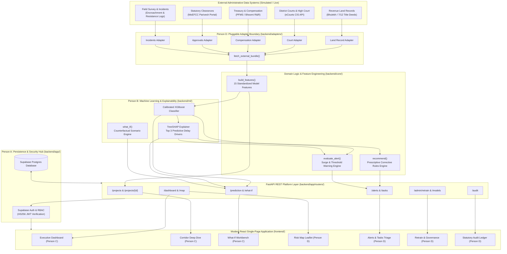

# LandSentinel: Predictive Analytics System for Early Detection of Land Acquisition Delays

> **AI-Powered Infrastructure Governance & Early Warning Platform**  
> *Transforming statutory land acquisition from reactive dispute firefighting into proactive risk mitigation.*

---

## 1. Executive Summary

Linear infrastructure projects in India (highways, expressways, rail corridors, irrigation canals, and urban transit) suffer average delays of **18 to 36 months** during the pre-construction land acquisition phase. Over **70% of delays** stem from uncoordinated bottlenecks: title disputes in local revenue courts, delayed tree-felling or forest clearances, pending compensation disbursements, and officer response backlogs. Traditionally, project authorities discover these compounding delays months after critical milestones have lapsed.

**LandSentinel** solves this challenge by integrating fragmented administrative data streams across revenue registries, district courts, clearance portals, and treasury disbursement records. Using calibrated machine learning (**XGBoost**) and game-theoretic explainability (**TreeSHAP**), LandSentinel quantifies delay probabilities up to **6 to 12 months in advance**, identifies the exact operational drivers behind risk spikes, and delivers automated, prescriptive policy recommendations directly to District Collectors and Project Managers.

---

## 2. Visual Walkthrough & Screenshots

| Executive Overview & Macro KPIs | Geospatial Corridor Risk Map |
|---|---|
|  |  |
| *Statewide risk scores, district comparisons, and active warning alerts.* | *OpenStreetMap corridor mapping with risk-scaled interactive markers.* |

| SHAP Explainability & Recommendations | What-If Scenario Workbench |
|---|---|
|  |  |
| *Top 3 SHAP drivers with plain-language context & prescriptive actions.* | *Interactive simulation of policy levers (compensation, legal fast-tracking).* |

| Early Warning Alerts & Corrective Directives | Model Retraining & Audit Ledger |
|---|---|
|  |  |
| *Score surge warnings (&ge;15 pts) and actionable directive assignments.* | *Champion/Challenger evaluation with immutable statutory audit logs.* |

---

## 3. System Architecture



---

## 4. Technology Stack

| Layer | Component / Library | Purpose & Rationale |
|---|---|---|
| **Backend API** | FastAPI (Python 3.11) | High-performance asynchronous REST endpoints, automatic OpenAPI docs, and strict Pydantic schemas. |
| **Authentication & RBAC** | Supabase Auth (HS256 JWT) | Role-based token verification and cryptographic claims enforcement across 5 distinct administrative roles. |
| **Database** | PostgreSQL / Supabase | Relational data integrity, foreign key cascades, JSONB flexibility for metrics/drivers, and statutory audit logging. |
| **Machine Learning** | XGBoost & Scikit-Learn | Calibrated gradient boosted trees optimized for class imbalance (PR-AUC / Brier score) and nonlinear risk interactions. |
| **Explainability** | TreeSHAP (`shap`) | Fast, mathematically sound feature attribution translating model logits into local probability point impacts. |
| **Frontend Framework** | React 18 & Vite | Rapid single-page component architecture with instantaneous hot-module replacement and clean code splitting. |
| **Styling & Icons** | Tailwind CSS & Lucide React | Modern, accessible utility-first styling with comprehensive government dashboard aesthetics. |
| **Data Visualization** | Recharts | Responsive, accessible SVG charting for risk trends, stage probabilities, and model comparison bars. |
| **Geospatial Mapping** | Leaflet & React-Leaflet | Open-source OpenStreetMap integration with custom risk-banded circle markers and dynamic bounds fitting. |
| **Automated Testing** | Pytest & TestClient | 140+ unit and contract shape tests validating adapters, features, alert thresholds, and REST contracts. |

---

## 5. Local Setup & Quickstart

### Prerequisites
- Python 3.11+
- Node.js 18+ & npm
- Git

### 1. Backend Setup
```bash
# Clone the repository
git clone https://github.com/nexilla/Predictive-Analytics-System-for-Early-Detection-of-Land-Acquisition-Delays.git
cd Predictive-Analytics-System-for-Early-Detection-of-Land-Acquisition-Delays

# Create and activate Python virtual environment
python -m venv .venv
# Windows:
.venv\Scripts\activate
# Linux/macOS:
# source .venv/bin/activate

# Install Python dependencies
pip install -r backend/requirements.txt

# Start backend in STUB_MODE (offline testing mode, no external DB needed)
$env:STUB_MODE="true"   # Windows PowerShell
# export STUB_MODE="true" # Linux/macOS
uvicorn app.main:app --app-dir backend --reload --port 8000
```
*API documentation is now available at `http://localhost:8000/docs`.*

### 2. Frontend Setup
```bash
# In a new terminal, navigate to the frontend directory
cd frontend

# Install dependencies
npm install

# Start the Vite development server
npm run dev
```
*The user interface will be accessible at `http://localhost:5173`.*

---

## 6. Demo Users & Scoped Administrative Roles

The platform provides 5 preconfigured persona accounts for testing role-based scoping and administrative permissions:

| Persona Name | Role Key | Email | Assigned Scope | Key Capabilities |
|---|---|---|---|---|
| **Priya Sharma** | `project_manager` | `pm1@landsentinel.gov.in` | Assigned projects in Pune (`PRJ-0001`, `PRJ-0002`) | Drafts/updates project records, runs what-if simulations, completes assigned corrective tasks. |
| **Rajesh Patil** | `collector` | `collector1@landsentinel.gov.in` | Pune District | Approves land acquisition projects, triages district alerts, assigns corrective directive tasks. |
| **Dr. Sunita Deshmukh** | `policymaker` | `policymaker1@landsentinel.gov.in` | Statewide (All Districts) | Reviews macro KPI trends, cross-district variance, high-level alerts, and policy interventions. |
| **Anand Verma** | `admin` | `admin1@landsentinel.gov.in` | Statewide (System Level) | Ingests new training CSV data, triggers retraining pipelines, evaluates & activates model versions. |
| **Kavita Rao** | `auditor` | `auditor1@landsentinel.gov.in` | Statewide (Read-Only) | Inspects statutory audit ledger, verifies model predictions, and exports audit records to CSV. |

---

## 7. What is Real vs. What is Simulated

To ensure transparency and academic integrity, here is an exact accounting of what is fully functional in LandSentinel versus what is simulated for demonstration:

### What is REAL:
1. **Machine Learning & Feature Engineering**: The 15 domain features in [`backend/core/features.py`](file:///c:/Desktop/nexilla/Predictive-Analytics-System-for-Early-Detection-of-Land-Acquisition-Delays/backend/core/features.py) are computed using real mathematical formulas (area-weighted possession, clearance delay metrics, R&R rates). The calibrated XGBoost model and SHAP explainability pipelines run actual numerical inference.
2. **Prescriptive Recommendation Rules**: The rule mapping in [`backend/core/recommend.py`](file:///c:/Desktop/nexilla/Predictive-Analytics-System-for-Early-Detection-of-Land-Acquisition-Delays/backend/core/recommend.py) dynamically translates SHAP feature attributions into targeted administrative directives based on Indian statutory land acquisition procedures (RFCTLARR Act 2013).
3. **Early Warning Alert Thresholds**: The alert engine in [`backend/core/alerts.py`](file:///c:/Desktop/nexilla/Predictive-Analytics-System-for-Early-Detection-of-Land-Acquisition-Delays/backend/core/alerts.py) calculates genuine score surges (&ge;15 points) and threshold crossings (>60) with stateful deduplication.
4. **Security & Cryptographic RBAC**: The FastAPI backend performs real HMAC-SHA256 JWT signature verification and role-scoping checks on every request.
5. **Interactive Frontend Pages**: All 7 frontend monitoring and core views (Dashboard, Corridor Deep Dive, What-If Workbench, Risk Map, Alerts Triage, Model Retraining, and Audit Log) are fully interactive React components with live state management.
6. **Automated Test Suite**: 140+ unit and contract shape tests run across the codebase, ensuring strict compliance with API contracts.

### What is SIMULATED:
1. **Administrative Data Sources**: Live government departmental APIs (such as the National Judicial Data Grid, Bhulekh 7/12 land records, and MoEFCC Parivesh clearance portals) lack open, public hackathon sandboxes. LandSentinel simulates these via structured CSV adapters in [`backend/adapters/`](file:///c:/Desktop/nexilla/Predictive-Analytics-System-for-Early-Detection-of-Land-Acquisition-Delays/backend/adapters/). However, the adapters implement a clean abstraction interface: swapping CSV readers with real REST or SOAP API clients requires **zero changes** to downstream feature extraction or ML inference.
2. **Training Data**: The historical and ongoing project datasets are generated using a statistically grounded data generator modeling realistic correlation structures between land disputes, compensation rates, and final acquisition delays.
3. **Retraining Worker**: The online retraining pipeline demonstrates real evaluation metric comparisons (PR-AUC, Brier score, Recall) and model version promotion, running synchronously or via worker stubs.
