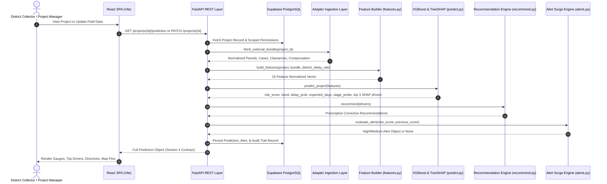

# LandSentinel System Architecture & Data Integration Guide

**Document Version:** 1.0.0  
**Scope:** Data Flow, Architectural Boundaries, and Pluggable Adapter Interface  
**Author:** Person D (Data Integration & Domain Logic)  

---

## 1. Architectural Overview

LandSentinel is structured into three clean, decoupled tiers designed for high maintainability, strict security, and zero-downtime integration with real government enterprise systems:

```
+-----------------------------------------------------------------------------------+
|                            PRESENTATION TIER (React SPA)                          |
|  Executive Dashboard | Corridor Deep Dive | What-If Simulation | Risk Map (Leaflet) |
|  Alerts & Directives | Retrain Governance | Statutory Audit Ledger (CSV Export)    |
+-----------------------------------------------------------------------------------+
                                         |
                                         | REST / HTTPS (Bearer JWT)
                                         v
+-----------------------------------------------------------------------------------+
|                           APPLICATION PLATFORM TIER (FastAPI)                     |
|  Authentication & RBAC (HS256) | Scoped Query Filters | Audit Action Interceptors |
|  Routers: /projects, /predictions, /dashboard, /map, /alerts, /tasks, /admin      |
+-----------------------------------------------------------------------------------+
       |                                   |                              |
       v                                   v                              v
+---------------+                 +--------------------+        +--------------------+
|  PERSISTENCE  |                 |    DOMAIN LOGIC    |        |  MACHINE LEARNING  |
|  Supabase     |                 |  15 Feature Engine |        | Calibrated XGBoost |
|  PostgreSQL   |                 |  Recommendation R. |        | TreeSHAP Explainer |
|  Row-Level S. |                 |  Alert Surge Logic |        | What-If Simulator  |
+---------------+                 +--------------------+        +--------------------+
                                           ^
                                           | Bundle Ingestion
                                  +--------------------+
                                  |   ADAPTER LAYER    |
                                  | Court, Land Record |
                                  | Comp, Approvals    |
                                  | Incidents Adapters |
                                  +--------------------+
                                           ^
                                           | Normalized Data
                       +---------------------------------------+
                       |   EXTERNAL GOVERNMENT REPOSITORIES    |
                       |  eCourts | Bhulekh | PFMS | Parivesh  |
                       +---------------------------------------+
```

---

## 2. End-to-End Data Flow

The complete data lifecycle follows a 6-stage unidirectional flow:



---

## 3. Pluggable Adapter Layer

### 3.1 Design Principle
Statutory land acquisition data in India resides across siloed departments:
- **Title and Land Registry**: State Revenue Departments (e.g., Mahabhulekh in Maharashtra, Bhoomi in Karnataka).
- **Litigation and Injunctions**: Judicial eCourts Case Information System (CIS) and National Judicial Data Grid (NJDG).
- **Statutory Clearances**: Ministry of Environment, Forest and Climate Change (MoEFCC Parivesh portal).
- **Financial Compensation**: Public Financial Management System (PFMS) and state treasury databases.
- **Law & Order / Encroachments**: District Collectorate field inspection reports.

The adapter layer in [`backend/adapters/`](file:///c:/Desktop/nexilla/Predictive-Analytics-System-for-Early-Detection-of-Land-Acquisition-Delays/backend/adapters/) insulates the core analytical engine from the complexities of these underlying systems.

### 3.2 Standard Contract Signatures
All adapters adhere to standard Python function signatures:
```python
# 1. Land Records Adapter
def get_parcels(project_id: str) -> list[dict]:
    """Returns: parcel_id, project_id, survey_no, area_ha, land_type, compensation_status, possession_status, doc_complete, ownership_dispute"""

# 2. Court Records Adapter
def get_cases(parcel_ids: list[str]) -> list[dict]:
    """Returns: case_id, parcel_id, category, filing_date, status, stay_order, hearings"""

# 3. Compensation Adapter
def get_compensation(project_id: str) -> dict:
    """Returns: project_id, award_amount, disbursed_amount, disputes"""

# 4. Approvals & Clearances Adapter
def get_approvals(project_id: str) -> list[dict]:
    """Returns: approval_id, project_id, name, planned_date, actual_date, status"""

# 5. Incidents & Encroachments Adapter
def get_incidents(project_id: str) -> list[dict]:
    """Returns: incident_id, project_id, type, incident_date, encroached_area_ha"""
```

---

## 4. How an Adapter Swap Works in Practice

When moving from a hackathon or pilot phase to a production state-wide rollout, developers swap the file-based adapter implementation with a live API client. **Crucially, zero lines of code change in `backend/core/features.py`, `backend/ml/`, or `backend/app/`**.

### Worked Example: Upgrading Court Adapter to eCourts CIS API

#### Step 1: Current File-Based Adapter (`backend/adapters/court_adapter.py`)
```python
class CourtAdapter(CsvAdapterBase):
    def get_cases(self, parcel_ids: list[str]) -> list[dict]:
        df = self._read_csv()
        filtered = df[df["parcel_id"].isin(parcel_ids)]
        return self._normalize_records(filtered)
```

#### Step 2: Production Live API Adapter (`backend/adapters/live_court_adapter.py`)
```python
import os
import requests
from typing import List, Dict, Any

class LiveCourtAdapter:
    def __init__(self):
        self.api_url = os.environ.get("ECOURTS_API_URL", "https://api.ecourts.gov.in/v1")
        self.api_key = os.environ.get("ECOURTS_API_KEY")

    def get_cases(self, parcel_ids: List[str]) -> List[Dict[str, Any]]:
        if not parcel_ids:
            return []
        
        response = requests.post(
            f"{self.api_url}/cases/batch_query",
            json={"survey_identifiers": parcel_ids},
            headers={"Authorization": f"Bearer {self.api_key}"},
            timeout=10
        )
        response.raise_for_status()
        raw_cases = response.json().get("cases", [])
        
        # Transform external JSON schema to LandSentinel canonical contract
        return [
            {
                "case_id": c["cnr_number"],
                "parcel_id": c["survey_identifier"],
                "category": self._map_category(c["case_type"]),
                "filing_date": c["date_of_filing"],
                "status": "pending" if c["stage"] != "DISPOSED" else "disposed",
                "stay_order": bool(c.get("interim_stay_granted", False)),
                "hearings": int(c.get("hearing_count", 0)),
            }
            for c in raw_cases
        ]
```

#### Step 3: Swapping via Environment Switch in `backend/adapters/__init__.py`
```python
USE_LIVE_APIS = os.getenv("USE_LIVE_APIS", "false").lower() in ("true", "1")

if USE_LIVE_APIS:
    from .live_court_adapter import LiveCourtAdapter
    _court_adapter = LiveCourtAdapter()
else:
    from .court_adapter import CourtAdapter
    _court_adapter = CourtAdapter()

def get_cases(parcel_ids: list[str]) -> list[dict]:
    return _court_adapter.get_cases(parcel_ids)
```

Because `build_features` only consumes the returned Python dictionaries, the entire feature calculation, XGBoost inference, and SHAP attribution continue operating identically.

---

## 5. Privacy and Security Guardrails

1. **Owner Anonymization**: Citizen personal identifiable information (PII)—specifically landowner names and Aadhaar numbers—is strictly stripped at the adapter boundary. Neither the database nor the frontend ever receives landowner identity attributes.
2. **Role-Based Row Scoping**:
   - `project_manager`: Filtered to assigned projects via `created_by = user_id`.
   - `collector`: Scoped to `district = user.district`.
   - `policymaker` & `admin`: Statewide visibility.
   - `auditor`: Immutable read-only view.
3. **Statutory Audit Log**: Any update to project parameters, retraining operation, or model activation triggers an automated insert into `audit_log` capturing the authenticated user, timestamp, action type, and affected project ID.
